# JFNetworker

JFNetworker is a network simulator and a lab for distributed systems, written in Rust with
[JFLib](https://github.com/JFLibrary/JFLib) (the crates on [crates.io](https://crates.io/crates/jflib)).
It is an alternative to Cisco Packet Tracer: devices and cables on a canvas, real protocols byte for
byte, IOS-like command lines on routers and switches, a Linux-like shell on hosts and a simulation
mode that steps through every frame. On top of that come services for building and measuring
horizontally scaled systems, and an Akademie with courses to learn networking. Until November 2026
it lived in the JFLib repository (`apps/JFNetworker`).

Windows and Linux · German and English · MIT licence

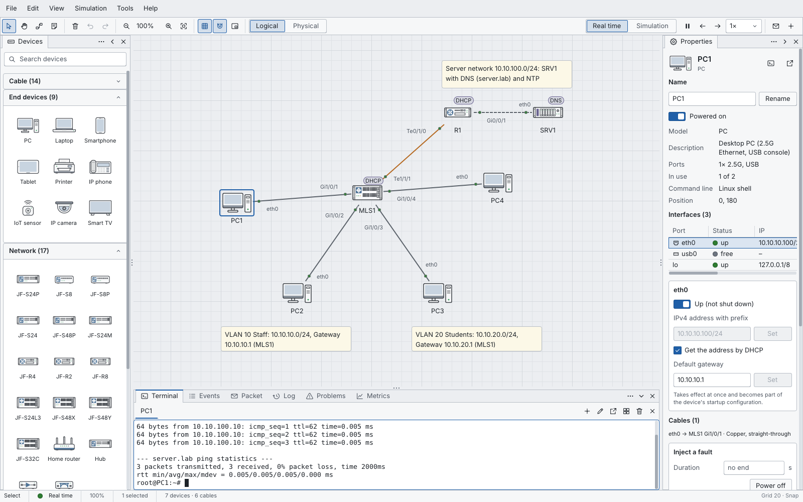

*A campus with two VLANs, DHCP through a relay and DNS; PC1 has just pinged `server.lab`.*

## Features

- **Topology editor:** 49 vendor-neutral device models, from PCs, phones and IoT devices to access,
  leaf and spine switches, routers, firewalls, Wi-Fi access points and rack servers; drag, click or
  place them with the keyboard. Connect with a port choice and an automatic or chosen cable: copper
  straight and crossover (Cat5e to Cat8), multimode and single-mode fibre (OM3 to OS2), serial with a
  chosen end, console, telephone, coax, DAC, AOC, WAN and radio. Cables show LEDs, waypoints and
  colours; notes, slim labels, groups, a background picture and undo for everything.
- **A real simulator:** every frame is built byte for byte with real checksums. Switching with VLANs
  and spanning tree (STP, RSTP), IPv4 and IPv6 with ARP and Neighbor Discovery, static routing, RIP,
  OSPF and BGP, NAT and access lists, a firewall with zones and stateful inspection, UDP and TCP
  (RFC 9293), DHCP with relays, DNS, NTP, syslog, HTTP and HTTPS with real TLS 1.3, SSH, Telnet,
  SNMP v1 to v3, RADIUS, 802.1X, Wi-Fi with WPA2/WPA3, mail with SMTP, POP3 and IMAP, TFTP and FTP.
- **Consoles:** IOS-like on routers and switches (modes, `?`, Tab, `show` commands, `copy run start`
  as an undo step) and a Linux-like shell on hosts with folders, pipes, processes and the classic
  tools (`ip`, `ping`, `traceroute`, `dig`, `curl`, `ssh`, `grep`, `top` …), in the Terminal panel,
  in a window of their own or in the device window.
- **Simulation mode:** packets as envelopes on the cables, steps forward and back, an event list with
  a timeline per protocol, a packet view with layers, fields, bytes and checksums, your own PDUs,
  export as pcapng; rewind shows every device as it was at any point of the recording.
- **A computer in every host:** a small desktop with windows and a taskbar: terminal, file manager,
  text editor, IP configuration, web browser (pages from the simulated network, forms, cookies,
  page scripts, developer view), e-mail, MIB browser, system monitor and an IDE for
  [JFScript](https://github.com/JFLibrary/JFScript) with a debugger and tests.
- **Akademie:** courses as files, installed from GitHub with one click or from a folder: lessons
  with drawings, labs in the simulator with goals it checks as you work, quizzes, exams and fault
  hunts in broken networks. Two courses come along (network basics and fault finding), in German and
  English.
- **Architecture lab:** load generators, web servers, load balancers, a sharded key-value store,
  caches, queues and workers, and a relational-style database with SQL-shaped statements, a buffer
  pool, row locks, MVCC, a write-ahead log and crash recovery; CPU and RAM per device, fault
  injection, metrics with percentiles and experiments that sweep the load to compare scaling up with
  scaling out.
- **Everything else:** a start page with templates and recent files, a physical view with buildings,
  rooms and racks (cable lengths with the limits of their medium), labs and graded assessments,
  autosave, keyboard operation throughout, screen reader names for devices and cables, light and
  dark themes. Projects are `.jfnet` files (indented JSON).

## The editor and the simulation mode

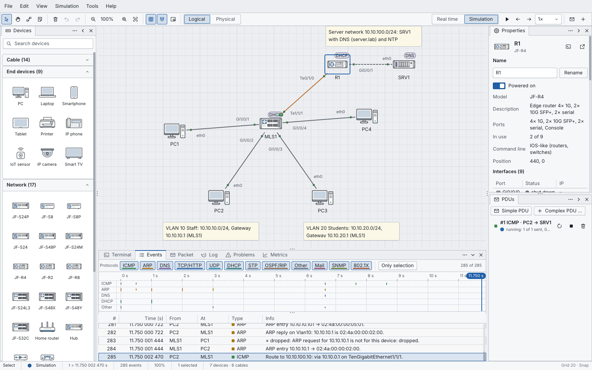

*PC2 pings SRV1 in the simulation mode: first the ARP request for its gateway, then the echo. The
event list shows what every device did with each frame.*

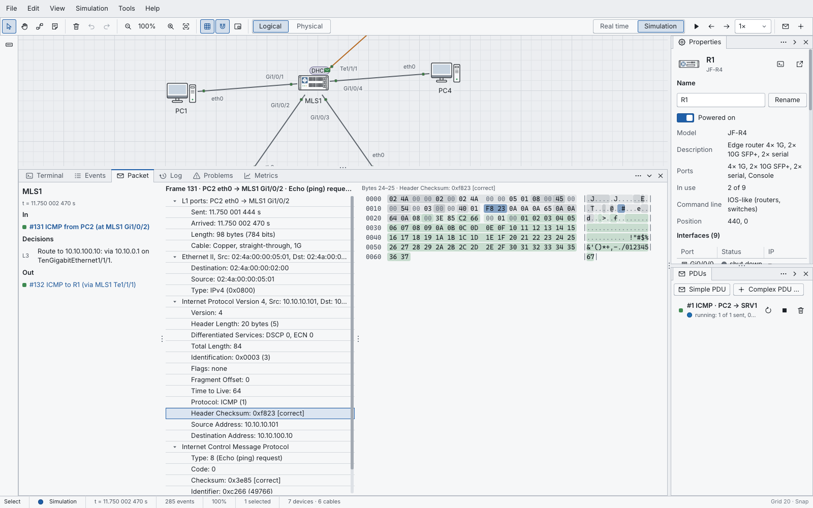

*The Packet tab shows a device's step: the frame that came in, the decision (here MLS1 routes the
echo to R1) and the frame that went out, every field with its bytes.*

## Devices and consoles

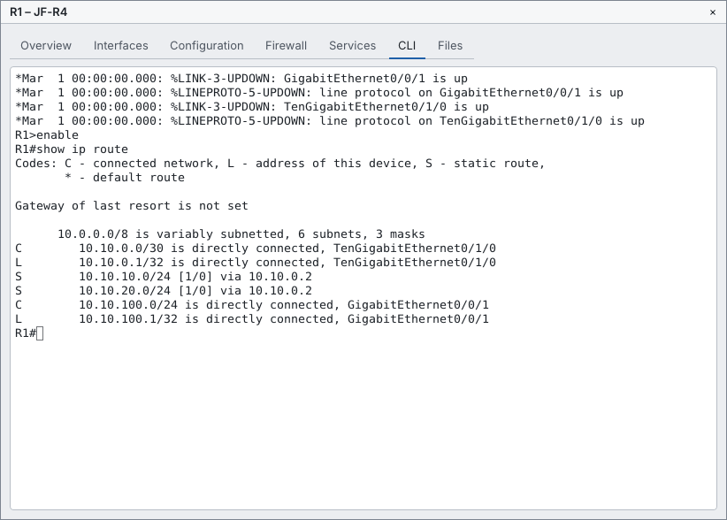

*A router's device window: overview, interfaces, configuration forms, firewall, services, the CLI
and its files. The forms type the matching commands, so the CLI shows what a click did.*

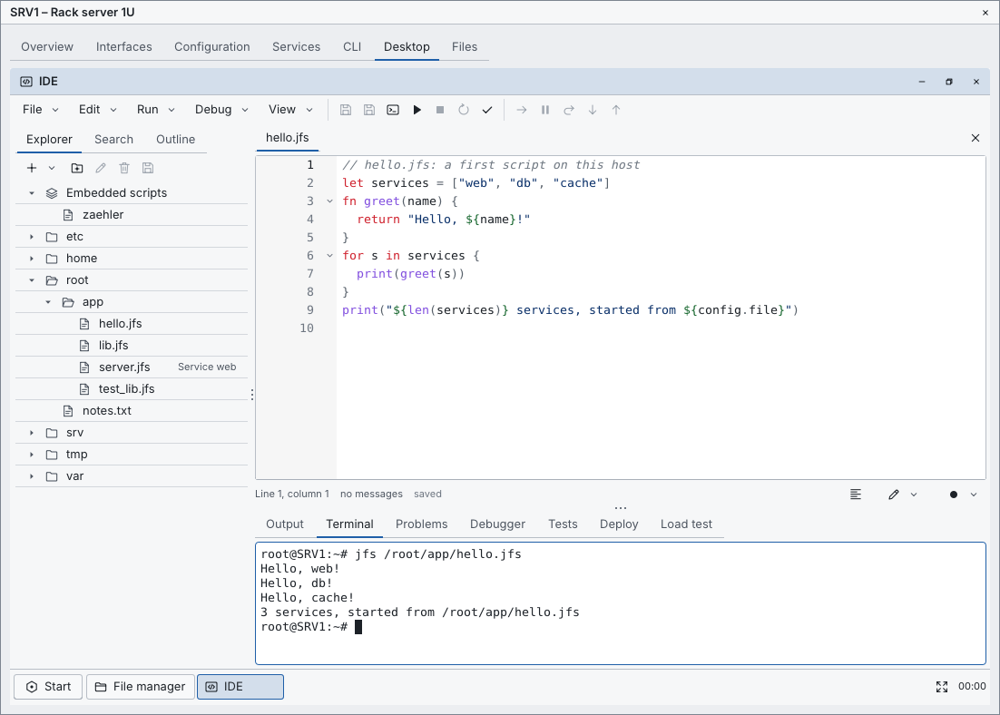

*The desktop of a server with the IDE: a JFScript file from the device's disk, run as a process.
Scripts can also run as services that answer HTTP, talk TCP and UDP and cost CPU time like real
programs.*

## The Akademie

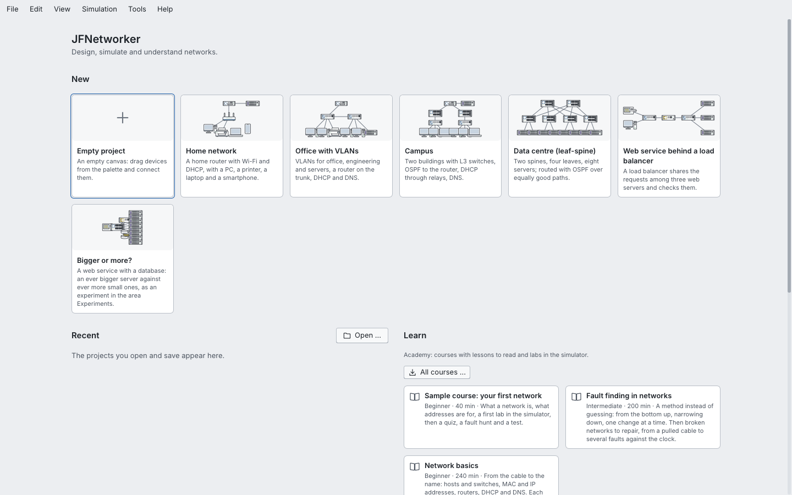

*The start page: an empty project or one of six templates, recent files, and the Akademie.*

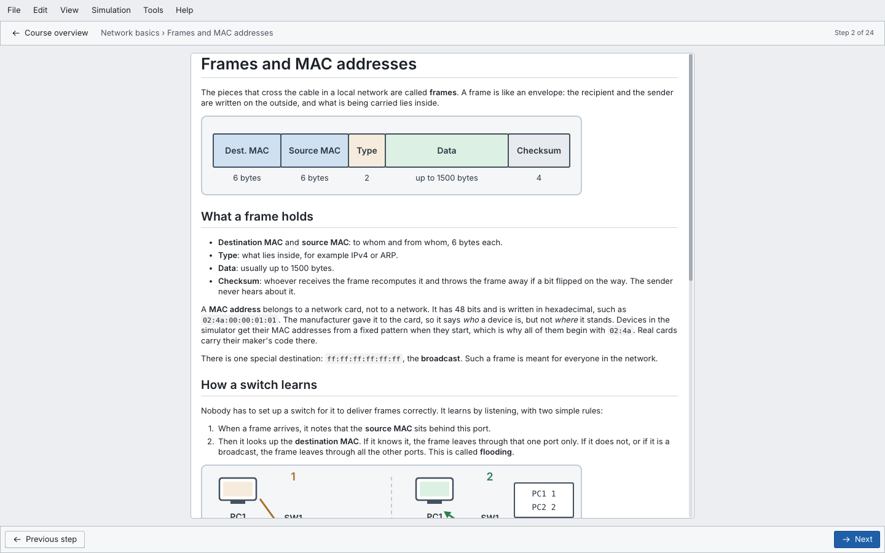

*A lesson. Every command and every console output a lesson quotes is checked against the simulator
by a self-test, so a lesson never shows something the simulator does not do.*

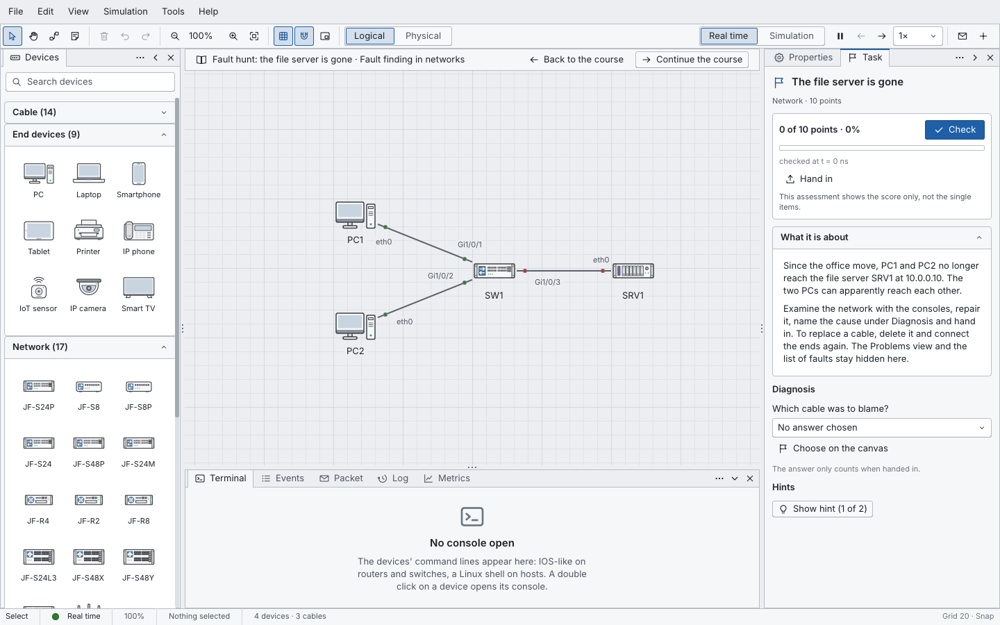

*A fault hunt: repair the network, name the cause, hand in. The Problems panel stays hidden here.*

## The architecture lab

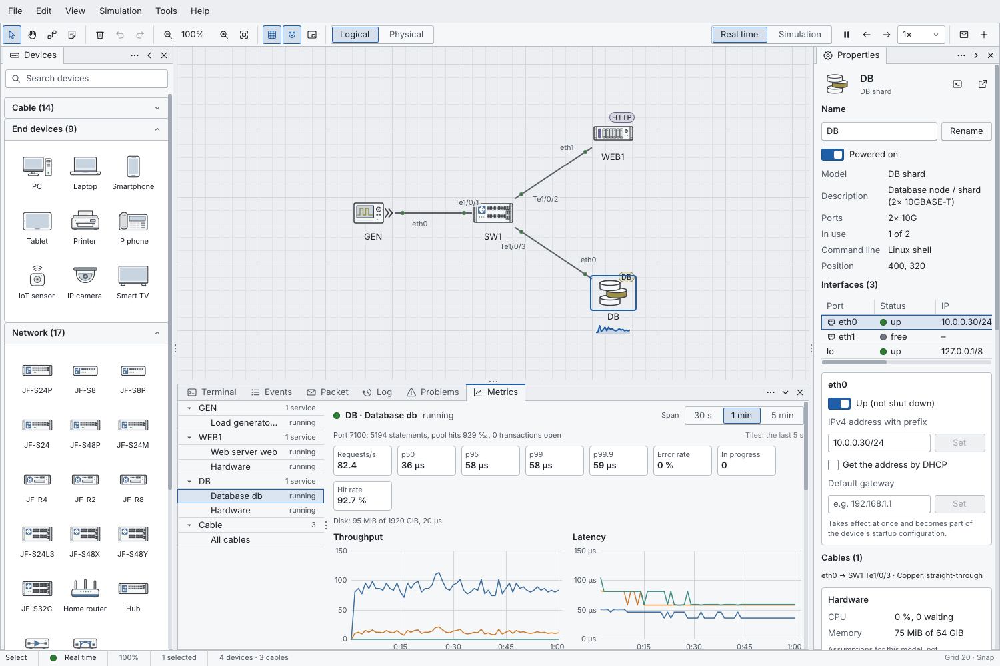

*A load generator, a web server and the database `db` under load. Throughput, percentiles up to
p99.9, error rate and the buffer pool's hit rate, per service and per second.*

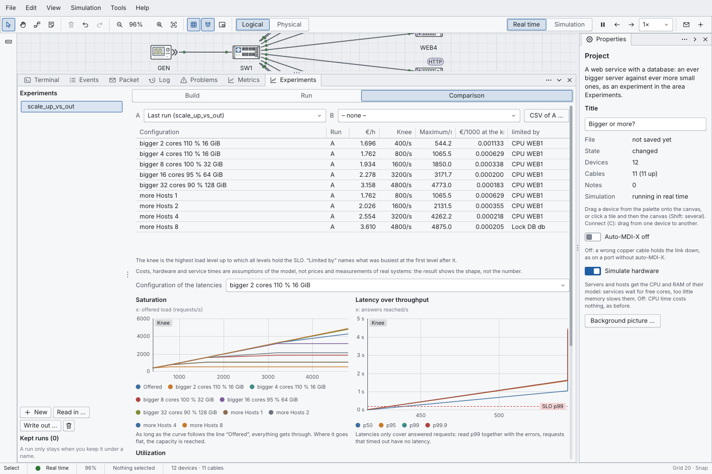

*The template "Bigger or more?" as an experiment: an ever bigger server against ever more small ones,
the same load levels for each. The table names the knee, the cost per 1000 requests there and what was
busiest; here eight hosts end at the database's lock on a hot row. Costs and hardware are assumptions
of the model, the shape of the curves is the point.*

## Dark theme

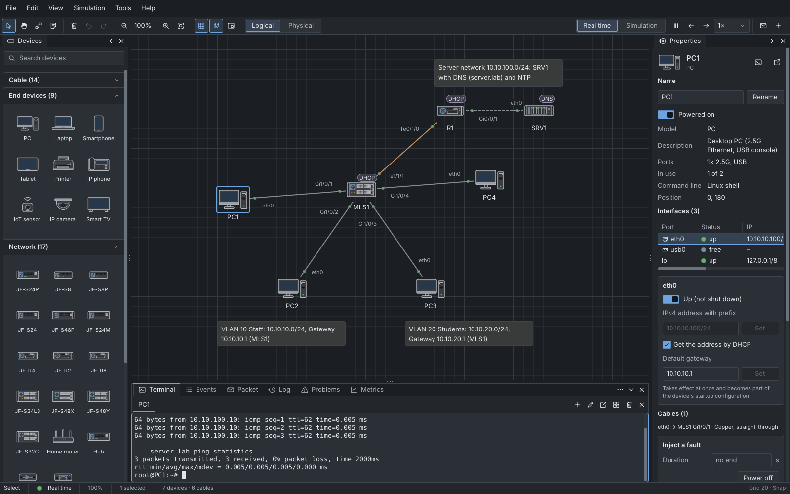

*The same campus in the dark theme of the style netlab, which JFNetworker brings along.*

## Build and run

You need Rust through rustup (1.98 or later), the tool `cargo jflib` for the test scripts, and Python
3.11 for the scripts in `tools/`:

```sh
cargo install cargo-jflib
```

JFLib comes from crates.io and [JFScript](https://github.com/JFLibrary/JFScript) from its repository.
**Until the next JFLib release** a JFLib checkout lies beside this repository: JFNetworker's style
`netlab` is not on crates.io yet, so `.cargo/config.toml` takes it, and every other JFLib crate with
it, from `../JFLib` (`tools/jflib_patch.py` writes that table).

```sh
git clone https://github.com/JFLibrary/JFLib ../JFLib
git clone https://github.com/JFLibrary/JFNetworker
cd JFNetworker
```

### Windows

```sh
cargo build --workspace          # target/debug/JFNetworker.exe and jfn-sim.exe
cargo run                        # the editor
cargo run -- --lang en           # in English
cargo run -- --open tests/fixtures/campus.jfnet
```

### Linux

Always build with `--target x86_64-unknown-linux-gnu`, also on Linux: the flags in
`.cargo/config.toml` then reach only the programs.

```sh
cargo build --workspace --target x86_64-unknown-linux-gnu
target/x86_64-unknown-linux-gnu/debug/JFNetworker
```

### jfn-sim

`jfn-sim` is JFNetworker without a window: it runs scenarios against projects and compares their
reports, checks projects and courses, decodes frames, installs courses and runs experiments at full
speed on several threads.

```sh
cargo run -p jfn-sim -- run tests/fixtures/lan_router.jfnet --scenario tests/scen/lan_router.scn
cargo run -p jfn-sim -- course academy/grundlagen
cargo run -p jfn-sim -- sweep tests/experiments/db_scale.jfnex tests/experiments/db_scale.jfnet --threads 4
```

## Tests

```sh
cargo jflib test                 # every window script in tests/ (about 200), Windows
python tools/linux_test.py       # the same on Linux, from Windows through WSL
python tools/goldens.py          # the golden scenarios through jfn-sim, byte for byte on every system
python tools/academy_e2e.py      # installing courses over real HTTP against a local server
```

The window scripts run the program without a real window: they click, type and compare what the
window shows, and take pictures light and dark at 100 and 150 % into `build/jfnetworker/`. The
self-test (`JFNetworker --selftest --academy-dir academy`, part of `tests/model.uis`) runs about
16 000 checks of the model, the simulator and the courses. CI checks the build on Windows and Linux
with the promised and the newest Rust and runs the golden scenarios on both.

The pictures in this README come from `python tools/readme_shots.py` (the scripts in `docs/shots/`).

## Status and current limits

The plan's phases 1 to 6 are done; phase 7 (more hardware, the firewall, the Akademie and the
architecture lab) is under way: replication, traffic control and an autoscaler for the lab, and
more courses come next ([roadmap](docs/ROADMAP.md)).

- **Packages:** setup and .deb packages wait for a version of `cargo jflib` that knows the style
  `netlab`.
- **Courses:** two courses so far; the lessons were checked against the simulator, not yet by a
  second reader.
- **Simplifications:** Wi-Fi associates on layer 2, signal and rate follow the distance without real
  radio physics; a hub repeats without collisions; cable and DSL modems and coax carry no data yet; vendor-specific protocols (CDP, EIGRP,
  VTP, HSRP) stay out.
- **Language:** the window is German and English; what a project file brings along (names,
  descriptions, notes) stays in the language it was written in.

## Documentation

The developer documentation is in German:

- [Overview](docs/OVERVIEW.md): what each part of JFNetworker does, milestone by milestone
- [Usage](docs/USAGE.md): the window, the tools, the panels and the keyboard
- [Building and testing](docs/BUILDING.md): every test script and what it checks
- [Reference](docs/REFERENCE.md): the simulator, the protocols, the consoles, the lab, the Akademie
  and their file formats
- [Performance](docs/PERFORMANCE.md) and the [roadmap](docs/ROADMAP.md)
- [JFScript](https://github.com/JFLibrary/JFScript), the scripting language of the hosts
- [JFLib](https://github.com/JFLibrary/JFLib), the library

## Trademarks

Cisco, Cisco IOS and Packet Tracer are trademarks of Cisco Systems, Inc. JFNetworker is an
independent alternative and not affiliated with or endorsed by Cisco. Its command lines follow the
command words and syntax learners know; help texts, messages, banners and courses are written in
JFNetworker's own words ([details](docs/TRADEMARKS.md), German).

## Licence

MIT ([LICENSE](LICENSE)). DejaVu Sans Mono, the consoles' font, comes with its own licence
([fonts/DejaVu-LICENSE.txt](fonts/DejaVu-LICENSE.txt)).
